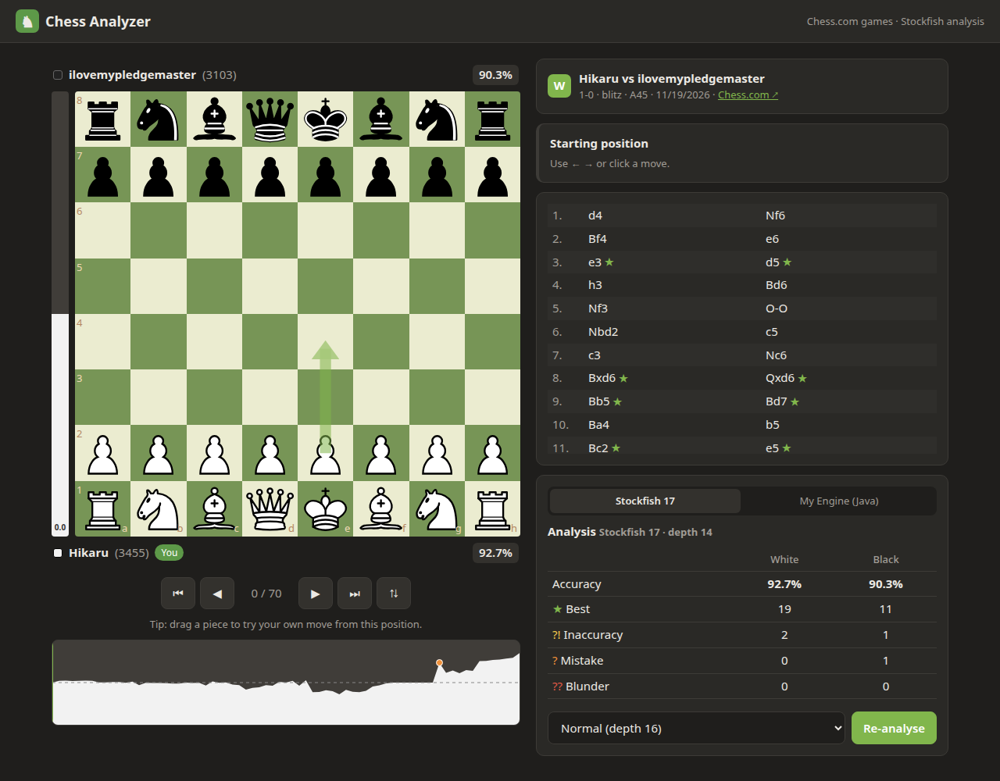
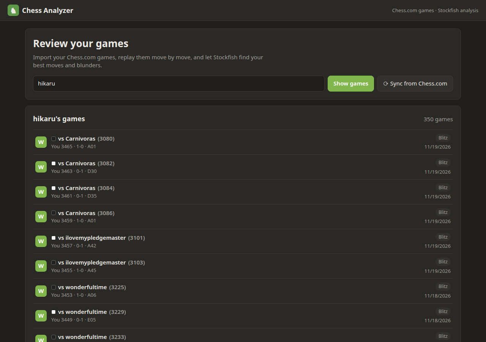
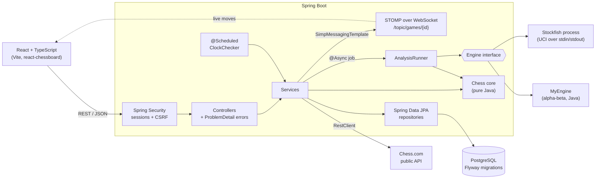

# ♞ Chess Analyzer

[](https://github.com/pranay-999/chess-analyzer/actions/workflows/ci.yml)

Import your **Chess.com** games, replay them move by move, and find your mistakes
with **Stockfish** or with a **chess engine written from scratch in Java**.



Built with **Java 21 · Spring Boot 4 · PostgreSQL · React + TypeScript · Docker**.

## Features

- **Import** all games of any Chess.com player (public API), incrementally: re-syncs only fetch new months.
- **Replay** games on an interactive board with keyboard navigation.
- **Engine analysis** of every move as a background job with live progress:
  **Brilliant !!** (good sacrifices) / **Great !** (only good move) / Best / Good / Inaccuracy / Mistake / Blunder,
  with a sentence explaining *why*, the move you should have played,
  a label badge on the board itself, your own arrows (right-drag) and marked squares (right-click),
  accuracy %, an evaluation bar, and a clickable evaluation graph.
- **Two engines**: Stockfish 17 (over the UCI protocol) and **my own engine**
  (negamax, alpha-beta, quiescence search, MVV-LVA ordering, piece-square tables),
  side by side on the same game.
- **Play online against other people**: sign up, log in, or play as a guest; a live lobby
  plus invite links; moves pushed over **WebSockets (STOMP)**; server-side clocks and rules,
  so the browser can't cheat; finished games go straight to the analyser.
- **Play against bots** with clocks: 7 levels, from my own engine at depth 1 to Stockfish at full
  skill. The server validates every move and detects checkmate, stalemate, repetition, the 50-move
  rule and insufficient material; finished games open in the analyser with one click.
  **Pre-moves**: queue your next move while the bot or your online opponent is thinking.
- **Puzzles from your own mistakes**: every Mistake/Blunder you make (Stockfish-analysed) becomes a puzzle,
  scheduled with **spaced repetition**. Equally good alternative answers are accepted after a Stockfish check.
- **Stats dashboard**: score by colour, time control and opening; rating and accuracy by month; where your
  mistakes happen (opening / middlegame / endgame). Computed in PostgreSQL with CTEs and `GROUP BY`.
- **Tap-to-move** on every board (tap a piece, then a square), as well as drag-and-drop.
- **Import from anywhere**: Chess.com and Lichess **game links**, PGN or FEN. Only **finished** games are
  accepted (fair play), and the server checks this with each site.
- **Phone-ready**: installable web app (PWA). On **Android** it appears in the Chess.com app's **Share** menu;
  on **iPhone**, a one-tap *Paste from clipboard*.
- **Browser extension** (Chrome, Edge, Firefox): an *Analyse* button on Chess.com and Lichess game pages, plus
  right-click → analyse any selected PGN/FEN (`extension/`).
- **Themes**: Light, Dark, Wood, Navy or Auto, plus 5 board colours.
- **Analysis board**: paste any **PGN** (a whole game from any site) or **FEN** (a position)
  and get the same replay, analysis and exploration tools.
- **Explore variations**: drag pieces to try your own moves. Legality is checked by
  the Java rules engine, and Stockfish evaluates each position live.
- **Chess rules implemented from scratch**: move generation, FEN, SAN and PGN,
  verified with standard **perft** counts and 463 real games.



## Architecture



Design choices worth noting:

| Decision | Why |
|---|---|
| Chess core has **no Spring** | Pure, fast unit tests; reused by import, analysis and the variation explorer. |
| Analysis is an **async job** (`POST` → 202, then poll `GET`) | A game takes 20–60 s. HTTP requests stay fast, and the UI shows progress. |
| Slow engine work runs **outside DB transactions** | Short transactions; results are saved in one small transaction at the end. |
| `Engine` **interface + factory** | Stockfish and my own engine are interchangeable; adding a third touches one class. |
| **Flyway** owns the schema, Hibernate only `validate`s | Versioned, reviewable SQL instead of auto-generated tables. |
| **Win-probability** based move labels (Lichess formula) | Losing 2 pawns at +10 is harmless; at 0.0 it loses the game. |
| Online games: **server is the referee**, REST for commands, WebSocket only for pushes | No cheating from the browser; commands stay simple to secure and test. |
| **Optimistic locking** (`@Version`) on online games | A move and a timeout arriving together can't overwrite each other (409 instead). |
| Session cookie + `csrf.spa()` instead of JWT | Less code, HttpOnly cookie can't be stolen by XSS, works directly with WebSockets. |

## Quick start (Docker)

Needs only Docker:

```bash
docker compose --profile app up --build
```

Open http://localhost:8080, enter a Chess.com username and click **Sync from Chess.com**.
(The image bundles Stockfish. The first build takes a few minutes.)

## Deploy (HTTPS, for phones and a live demo)

`render.yaml` + the `prod` profile deploy the app and a PostgreSQL database on Render. See **[docs/DEPLOY.md](docs/DEPLOY.md)**.

## Development setup

Requires Java 21, Maven, Node 22, Docker, and Stockfish (`sudo apt install stockfish`).

```bash
docker compose up -d                  # PostgreSQL only (port 5433)
mvn spring-boot:run                   # backend on :8080
cd frontend && npm install && npm run dev   # UI with hot reload on :5173 (proxies /api to :8080)
```

`npm run build` writes the UI into `src/main/resources/static`, so Spring then serves everything on :8080.

## API

| Method | Endpoint | Description |
|---|---|---|
| `POST` | `/api/players/{username}/sync?months=N` | Import games from Chess.com |
| `GET` | `/api/players/{username}/games?page=0&size=20` | Paged list, newest first |
| `GET` | `/api/games/{id}` | Game with every move and position (FEN) |
| `POST` | `/api/games/import` | Store a pasted PGN or FEN (`{"text", "playerColor"}`) → 201 Created |
| `POST` | `/api/games/{id}/analysis?engine=stockfish&depth=16` | Start an analysis (202 Accepted) |
| `GET` | `/api/games/{id}/analysis?engine=my-engine` | Progress, or results when done |
| `GET` | `/api/auth/me` · `POST` `/api/auth/signup` `/login` `/guest` `/logout` | Accounts (session cookie + CSRF) |
| `POST` | `/api/online/games` | Create an online game `{minutes, increment, color, listed}` |
| `GET` | `/api/online/games/open` · `/mine` · `/{id}` | Lobby, your games, one game |
| `POST` | `/api/online/games/{id}/join` · `/moves` · `/resign` · `/cancel` | Play (validated on the server) |
| `WS` | `/ws` → subscribe `/topic/games/{id}`, `/topic/lobby` | Live updates (STOMP) |
| `GET` | `/api/players/{username}/stats?timeClass=` | Stats dashboard numbers |
| `GET` | `/api/puzzles/next?player=` · `POST` `/api/puzzles/{id}/attempt` · `/reveal` | Puzzles from your mistakes |
| `GET` | `/api/bots` | Bot levels |
| `POST` | `/api/bots/move` | `{level, moves}` → bot's reply + game status |
| `GET` | `/api/positions/moves?fen=…` | Legal moves of any position |
| `GET` | `/api/positions/eval?fen=…&engine=stockfish&depth=14` | Live engine evaluation |

Errors use the standard `application/problem+json` format (RFC 9457).

## Testing

```bash
mvn test        # 135 tests; needs Docker running (Testcontainers)
```

- **Perft tests** check that move generation matches published node counts exactly.
- **Unit tests** cover SAN/PGN parsing, move classification maths, UCI parsing, and engine tactics.
- **Web tests** use MockMvc for controllers and `MockRestServiceServer` for the Chess.com client.
- **Integration test** (`AppIntegrationTest`): the whole app with a real PostgreSQL in
  **Testcontainers**: import → browse → analyse → poll, over real HTTP.
- **CI**: GitHub Actions runs the Java tests and the frontend lint and build on every push.

## Project structure

```
src/main/java/com/chessanalyzer/
├── chess/        rules engine: Board, MoveGenerator, San, PgnParser (no Spring)
├── chesscom/     Chess.com API client + DTOs
├── game/         entities, repositories, import + query services
├── analysis/     async analysis jobs, move classification (MoveAnalyzer)
├── engine/       Engine interface, Stockfish (UCI), EngineFactory
│   └── myengine/ my alpha-beta engine + evaluation
├── position/     legal moves + live eval for the variation explorer
└── web/          REST controllers, global error handler
frontend/src/     React pages, components, typed API client
docs/             step-by-step notes for every phase of the project
```

## What I learned

The `docs/` folder has a write-up per phase: Spring dependency injection,
JPA relationships and lazy loading, transactions, `@Async` and the proxy
self-invocation trap, Flyway migrations, the UCI protocol, alpha-beta search,
React state and effects, and Testcontainers.

## Roadmap

- Faster move generation (bitboards, make/unmake) and a transposition table for my engine
- Opening explorer and per-opening statistics
- Lichess import
